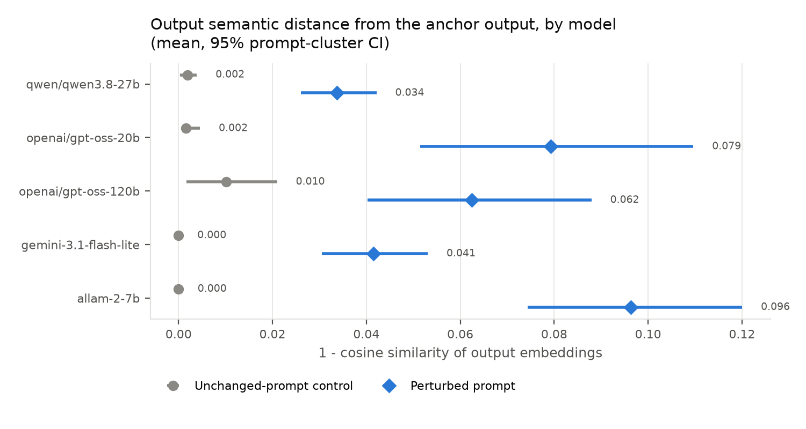

# Adversarial Prompt Sensitivity Analysis (APSA)

> *How much can a Large Language Model's output change when its input prompt is modified by
> minimal, controlled perturbations?*

APSA is a research framework for studying LLM prompt sensitivity as a constrained problem:

```text
maximize D_out(f(P), f(P'))   subject to   D_in(P, P') <= epsilon
```

It generates controlled prompt perturbations and measures how far each one changes the input
(character, word and embedding distance). It then runs original, unchanged-control and perturbed
prompts on live LLMs and measures the output change (embedding, character and token distance,
final-answer change, and correctness by answer key or unit tests). Finally, it analyses the results
with paired, prompt-clustered statistics.

## Status (2026-11-20)

| Item | Status |
|---|---|
| Phases 1–10 framework | Audited; provider defects fixed ([baseline audit](docs/roadmap/repository_baseline_audit.md)) |
| Live main study `main_v1` | **Complete:** 2,870 / 2,875 live generations (5 models × 50 prompts × [1 anchor + 2 controls + ≤10 perturbations]) |
| Phases 11–17 | Complete with accepted limitations ([verification report](docs/roadmap/phases_11_to_17_verification.md)) |
| Research paper | [docs/paper/APSA_research_paper.md](docs/paper/APSA_research_paper.md) · [.docx](docs/paper/APSA_research_paper.docx) |
| Tests | **231 passed** (`.\.venv\Scripts\python.exe -m pytest -q`) |

### Key results

| Finding | Value |
|---|---|
| Output text changed: perturbed vs re-sent identical prompt | **66% vs 7%** |
| Semantic output distance: perturbed vs control | 0.061 vs 0.003 (Wilcoxon *p* = 6×10⁻⁴¹) |
| Correctness flipped: perturbed vs control | **4.3% vs 0%** (500 controls) |
| Correct→incorrect: meaning-altering vs meaning-preserving edits | **17.6% vs 1.0%** |
| Flip rate: strong models vs the 7B model | 0.9–3.1% vs 14.4% |
| Most / least disruptive operator | instruction reordering / word deletion |
| Input edit size predicts output change? | Barely (Spearman ρ ≤ 0.14) |



Mock runs exist only to test the software. **They are never mixed into live results:** the analysis
filters on `execution_mode == "live"`.

## Setup (verified on Windows 10, Python 3.12)

```powershell
python -m venv --system-site-packages .venv
.\.venv\Scripts\python.exe -m pip install pytest pytest-cov python-Levenshtein rouge-score `
    scikit-learn requests statsmodels openai google-genai python-docx `
    "transformers==4.46.3" "sentence-transformers==3.3.1" "tokenizers<0.21"
.\.venv\Scripts\python.exe -m pip install -e . --no-deps
copy .env.example .env   # then fill GROQ_API_KEY and GEMINI_API_KEY (free tiers)
```

`requirements-lock.txt` lists the exact versions used for the study. Newer `transformers`
releases are incompatible with torch 2.5. API keys are read only from `.env` or the
environment, never from config files.

## Reproduce the study

```powershell
# 1. Offline software check (no API calls, writes to results\mock_runs)
.\.venv\Scripts\python.exe experiments\run_study.py --study-id smoke --mock --output-root results\mock_runs

# 2. Live study (free tiers; resumable: re-run the same command to continue after a quota stop)
.\.venv\Scripts\python.exe experiments\run_study.py --config config\experiments\main_study.yaml --study-id main_v1

# 3. Analysis: statistics, figures, case studies -> results\study\main_v1\analysis
.\.venv\Scripts\python.exe experiments\analyze_study.py --study-dir results\study\main_v1

# 3b. Browse every output pair in a browser (writes analysis\output_viewer.html)
.\.venv\Scripts\python.exe scripts\build_output_viewer.py --study-dir results\study\main_v1

# 3c. One-prompt walkthrough for demos (recorded data by default; add --live for a real call)
.\.venv\Scripts\python.exe experiments\demo.py --prompt-id QA-001 --operator punctuation --model allam-2-7b

# 4. Tests
.\.venv\Scripts\python.exe -m pytest -q

# 5. Paper -> .docx
.\.venv\Scripts\python.exe scripts\build_paper_docx.py docs\paper\APSA_research_paper.md
```

The runner waits out per-minute HTTP 429 limits using the provider's suggested delay. It stops a
model only when the wait would exceed `--max-wait-seconds` (a daily quota), and records that stop
in `failures__<model>.jsonl`.

## Output layout (`results/study/<study_id>/`)

| Path | Content |
|---|---|
| `study_manifest.json` | config + SHA-256, dataset SHA-256, selected prompt IDs, per-run status |
| `candidates.jsonl` | every perturbation candidate (accepted or rejected with reason) and its input distances |
| `raw/generations__<model>.jsonl` | immutable, append-only raw generations (one per API call) |
| `raw/failures__<model>.jsonl` | failed calls, rate-limit stops |
| `processed/analysis_pairs.csv` | anchor-paired analysis dataset (links to raw `record_id`s) |
| `processed/generations_scored.csv`, `exclusions.csv` | correctness per generation, exclusions |
| `analysis/results.json`, `results_tables.md` | every statistic reported in the paper |
| `analysis/figures/*.png`, `analysis/case_studies.json` | figures and case studies |
| `analysis/output_viewer.html` | interactive browser for all output pairs |

The completed study `results/study/main_v1` is included in this repository as the paper's evidence.
Other `results/` content, such as mock runs, is git-ignored.

## Documentation

- [Research methodology (RQ1–RQ5)](docs/research_methodology.md)
- [Statistical analysis plan](docs/roadmap/analysis_plan.md)
- [Repository baseline audit (Phases 1–10)](docs/roadmap/repository_baseline_audit.md)
- [Phases 11–17 verification report](docs/roadmap/phases_11_to_17_verification.md)
- [Research paper](docs/paper/APSA_research_paper.md)
- [Semantic-preservation audit](config/experiments/main_study_semantic_audit.yaml)
- [Progress note to supervisor](docs/progress_note_for_professor.md)
- [Software architecture](docs/software_architecture.md) · [Metrics](docs/metrics.md) ·
  [Dataset card](data/dataset_card.md)

The older lightweight pilot (`experiments/pilot_experiment.py`, `evaluate_experiment.py`) still
works and is kept for history. The main study uses `run_study.py` and `analyze_study.py`.
