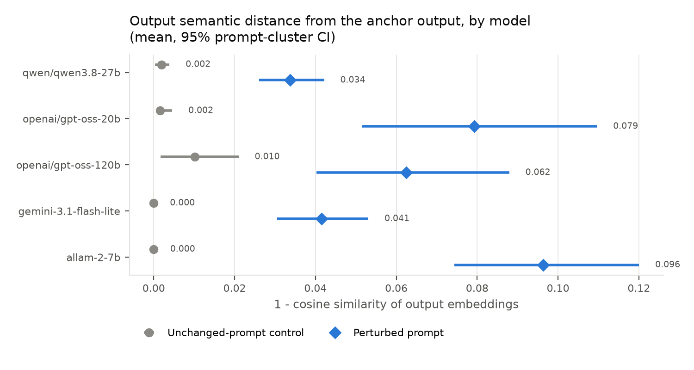
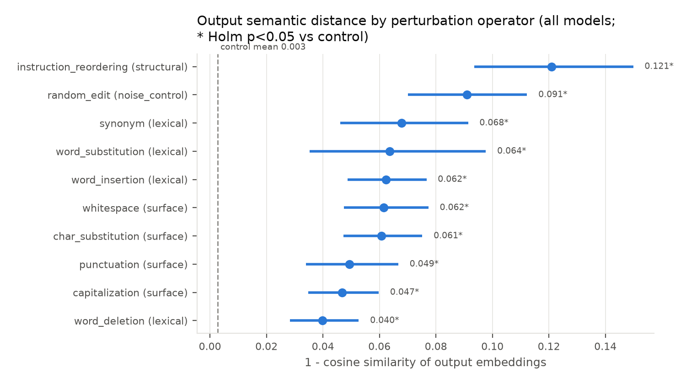

# APSA: Results Report

**Adversarial Prompt Sensitivity Analysis: Measuring LLM Output Changes under Minimal Prompt Perturbations**

**Abhinav Arora and Aditya Kumar Giri** · 20 November 2026
Repository: https://github.com/abhinav24020-cyber/APSA-Prompt-Sensitivity-Study

---

## 1. Summary

We measured how much large language models change their answers when a prompt is edited minimally (a typo, a missing question mark, a synonym, reordered sentences). We compared each edit against simply re-sending the *unchanged* prompt.

The live study covered 5 models × 50 prompts, with 2,870 API responses collected. Its main results:

- **Small edits clearly change outputs.** Edited prompts changed the output text in **66%** of cases, against **7%** when the identical prompt was re-sent. Mean semantic output distance was **0.061 vs 0.003** (paired Wilcoxon *p* = 6×10⁻⁴¹). The effect was significant for every model and every output metric.
- **Correctness changes are rarer but real.** Correctness flipped in **4.3%** of edited cases and in **0 of 500** controls. Flips went in both directions (2.3% correct→incorrect, 2.0% incorrect→correct), so overall accuracy was nearly unchanged.
- **Strong models keep their answers; a small model does not.** Gemini, GPT-OSS-120B, GPT-OSS-20B and Qwen flipped in 0.9–3.1% of cases. ALLaM-7B flipped in 14.4%.
- **Edits that alter the question cause most of the damage.** A semantic audit found 15 edits (3.5%) that unintentionally changed the task. They produced **17.6%** correct→incorrect flips, against **1.0%** for meaning-preserving edits.
- **Edit size barely predicts effect size** (Spearman ρ ≤ 0.14). Which token is edited matters more than how much text changes.

## 2. Progress since the last update

| Challenge (previous update) | What was done |
|---|---|
| API rate limits stopped the live run after 9 pairs | The cause was that the runner aborted on *any* HTTP 429, including per-minute limits. It now waits out short limits, stops only on daily quotas, and resumes. The full study then completed: **2,870 / 2,875 calls**. The 5 failures are genuine model errors, recorded and not imputed. |
| Reference answers needed validation; code answers needed execution | All 10 code items are now scored by executing unit tests, and every reference solution passes. The 40 other items use explicit, auditable answer rules. A check of 40 random verdicts found 39 correct, and the one error was fixed. |
| Perturbations do not guarantee preserved meaning | A systematic semantic audit was run. Results are reported both with and without the 15 meaning-altering edits. |
| Text-based heuristic metrics | Correctness is now measured with answer keys and unit tests. Text and embedding distances are secondary, with stated limitations. |
| Insufficient live coverage and controls | 5 models × 5 task categories, with 2 unchanged-prompt controls for every model and prompt (500 control pairs). |

## 3. Experimental setup

- **Prompts:** 50 of the 100 baseline prompts, 10 per category (mathematical reasoning, logical reasoning, question answering, classification, code generation). Selected by a fixed rule before any outputs were seen: answers must be automatically checkable.
- **Perturbations:** 10 operators with a fixed seed: character typo, capitalisation, punctuation, whitespace, word insertion, word deletion, synonym, word substitution, sentence reordering, and random character edits (a noise baseline). 425 perturbed prompts.
- **Models:** `qwen/qwen3.8-27b`, `openai/gpt-oss-120b`, `openai/gpt-oss-20b` and `allam-2-7b` (Groq), and `gemini-3.1-flash-lite` (Google). Temperature 0, 768-token cap, and the same instruction for every request.
- **Design:** per model and prompt, 1 original-prompt run (the reference), 2 unchanged repeats (controls), and 1 run per perturbed prompt. Every output is compared with the reference output.
- **Statistics:**
  - unit of analysis: model × prompt (250 units);
  - Wilcoxon signed-rank tests, with prompt-clustered bootstrap 95% CIs;
  - Holm correction across operators;
  - effect sizes: rank-biserial *r* and Cliff's δ;
  - group tests: Kruskal–Wallis and Friedman;
  - a mixed-effects model with a random intercept per prompt.

## 4. Main results

**Table 1. Perturbed vs control** (paired by model × prompt, all models)

| Outcome | Perturbed | Control | Difference [95% CI] | *p* |
|---|---|---|---|---|
| Semantic output distance (primary) | 0.061 | 0.003 | +0.059 [0.048, 0.070] | 6×10⁻⁴¹ |
| Character distance | 0.215 | 0.013 | +0.202 [0.172, 0.233] | 2×10⁻⁴¹ |
| Final answer text changed | 17.1% | 0.9% | +16.2 pts [12.6, 20.2] | 1×10⁻¹⁸ |
| Correctness flipped | 4.3% | 0.0% | — | — |

Note: "final answer text changed" is an upper bound, because it also counts rewording of the answer line.

**Table 2. By model** (perturbed prompts)

| Model | Baseline accuracy | Output change | Correctness flip rate |
|---|---|---|---|
| gemini-3.1-flash-lite | 100% | 0.041 | 0.9% |
| qwen/qwen3.8-27b | 98% | 0.034 | 3.1% |
| openai/gpt-oss-120b | 96% | 0.062 | 1.2% |
| openai/gpt-oss-20b | 96% | 0.079 | 2.1% |
| allam-2-7b | 60% | 0.096 | 14.4% |

Models differed significantly (Friedman *p* = 0.0006). ALLaM-7B's low baseline accuracy reflects frequent instruction-following failures.

**By perturbation type.**
- Every operator changed outputs significantly more than the control (all Holm-corrected *p* < 10⁻¹³).
- **Sentence reordering** was the most disruptive: the final answer changed in 39% of cases.
- **Word deletion** and **capitalisation** were the least disruptive.
- Surface edits were *not* the most disruptive family, contrary to our hypothesis H1.

**By task.** Logical and mathematical reasoning were the most sensitive. Code generation was the most stable: only 1 of 449 code cases went from passing to failing its unit tests (Kruskal–Wallis *p* = 0.004).

**Table 3. Meaning-preserving vs meaning-altering edits** (correctness flips)

| Edits | Pairs | Correct → incorrect | Incorrect → correct |
|---|---|---|---|
| Meaning-preserving | 1,796 | 1.0% | 1.8% |
| Meaning-altering (audit-flagged) | 74 | **17.6%** | 4.1% |
| Random character edits (noise baseline) | 250 | 7.2% | 3.2% |

## 5. Examples

Each example below differs from the original prompt by a single small edit:

| Model | Edit | Original answer | Answer after edit |
|---|---|---|---|
| ALLaM-7B | removed "?" from the 1921 Nobel Prize question | Albert Einstein ✔ | **Werner Heisenberg** ✘ |
| Qwen 3.8 27B | appended "." after a quoted Spanish sentence | Spanish ✔ | **Portuguese** ✘ |
| GPT-OSS-20B | "Classify" → "Categorize" (central-bank headline) | Business ✔ | **Politics** ✘ |
| Qwen 3.8 27B | one-character typo in a crash-report severity task | Critical ✔ | **High** ✘ |
| ALLaM-7B | lower-cased the first letter of a word problem | $7.20 ✔ | **$9.60** ✘ |

## 6. Research questions

| Research question | Finding | Hypothesis |
|---|---|---|
| RQ1: Which perturbation type matters most? | All types matter; reordering most, deletion least | H1 not supported |
| RQ2: Which tasks are most sensitive? | Reasoning most, code least | H2 partly supported |
| RQ3: Are larger, stronger models more robust? | The 7B model is far more fragile; strong models are robust in correctness (observational only) | H3 consistent, not established |
| RQ4: How does edit size relate to output change? | Weak relation; changes are threshold-like | H4 consistent (no formal test) |
| RQ5: Can searching find worse edits than random ones? | Best-of-operators 1.6× random; did not reliably beat random edits on held-out prompts | H5 not supported (proxy only) |

## 7. Limitations

- 50 prompts with one perturbation instance per operator; category estimates rest on 10 prompts each.
- Temperature 0 only. The 0.7 condition from the methodology was not run.
- Correctness is scored automatically (answer key and unit tests). The semantic audit has not yet been validated by independent human annotators.
- The embedding distance also reflects verbosity changes. The final-answer metric is an upper bound.
- Model comparisons are observational: the models differ in vendor, training and size at once.
- RQ5 was addressed only through operator selection, not token-level search.

## 8. Next steps

1. Validate the semantic audit and the scoring with a second human annotator and report Cohen's κ.
2. Extend to all 100 prompts with several random seeds per operator.
3. Add the temperature-0.7 condition.
4. Implement a greedy token-level adversarial search for RQ5.

## 9. Deliverables

- **Research paper draft:** `docs/paper/APSA_research_paper.docx`
- **Verification report for Phases 11–17:** `docs/roadmap/phases_11_to_17_verification.md`
- **Code, raw data (2,870 responses), analysis and figures:** https://github.com/abhinav24020-cyber/APSA-Prompt-Sensitivity-Study
- **Automated tests:** 231 passing
