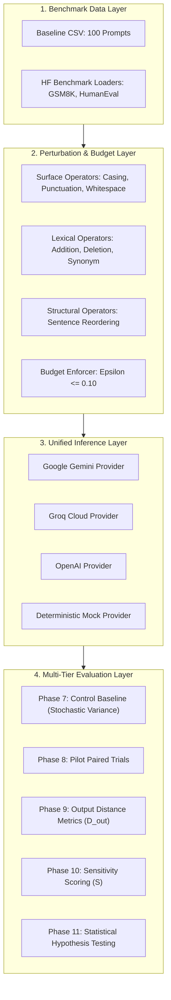

# APSA Project Architecture, Current Status, and Open Challenges

**Project Title:** Adversarial Prompt Sensitivity Analysis (APSA)  
**Document Type:** Technical Architecture & System Status Audit  
**Date:** November 2026  
**Audience:** Research Advisor, Professor, and Project Maintainers  

---

## 1. Executive Overview

The **Adversarial Prompt Sensitivity Analysis (APSA)** framework is designed to study the fragility and behavioral divergence of Large Language Models (LLMs) when subjected to minimal, semantics-preserving input prompt perturbations.

The core research question investigated is:
> *How much can an LLM's output change when its input prompt is modified by minimal, controlled perturbations under an epsilon budget ($\epsilon$)?*

The framework tracks experimental trials across **5 task categories**, **10 perturbation operators**, multiple **model providers**, and calculates both text-level output divergence ($D_{out}$) and **Adversarial Sensitivity Coefficients ($S$)**.

---

## 2. Target Project Architecture: How It Should Look

A complete, production-grade LLM robustness evaluation system consists of four layered subsystems:



### Ideal Directory Layout

```text
adversarial-prompt-sensitivity/
├── config/                          # YAML configurations
│   ├── default.yaml                 # Master default parameters
│   ├── models.yaml                  # Model registry & generation configs
│   ├── experiments/                 # Experiment profiles (pilot, mock, full)
│   ├── models/                      # Modular per-model YAMLs
│   └── perturbations/               # Operator parameters & budgets
├── data/                            # Benchmark datasets
│   ├── baseline_prompts.csv         # 100 curated benchmark prompts (20 per category)
│   └── dataset_card.md              # Dataset metadata documentation
├── docs/                            # Research & technical documentation
│   ├── research_methodology.md      # Mathematical & formal specifications
│   ├── software_architecture.md     # System design & class contracts
│   └── phase_1_to_10_verification_report.md
├── experiments/                     # High-level experiment execution scripts
│   ├── control_experiment.py        # Phase 7: Natural variance baseline
│   ├── pilot_experiment.py          # Phase 8: Paired trial generator
│   └── evaluate_experiment.py       # Phases 9 & 10: Metrics & Sensitivity scoring
├── scripts/                         # CLI entry points
│   ├── verify_environment.py        # Pre-flight environment check
│   ├── run_experiment.py            # Orchestrator runner (engine-based)
│   ├── run_analysis.py              # Statistical analyzer
│   └── run_visualization.py         # Markdown & HTML report generator
├── src/apsa/                        # Core Python library
│   ├── analysis/                    # Sensitivity analyzer & statistical tools
│   ├── config/                      # YAML loaders & Pydantic schemas
│   ├── data/                        # Dataset loaders & registry
│   ├── execution/                   # Engine, scheduler, trial runner, checkpointing
│   ├── llm_providers/               # Provider factory & implementations
│   ├── logging_/                    # Structured logging
│   ├── metrics/                     # Input/output distance & functional metrics
│   ├── perturbations/               # 10 perturbation operators & registry
│   ├── prompts/                     # Task prompt formatters
│   └── storage/                     # JSONL reader, writer & Pydantic schemas
├── tests/                           # Automated test suite (171 passing tests)
│   ├── unit/                        # Unit tests for operators, metrics, config
│   └── integration/                 # End-to-end execution tests
├── .env                             # Local API keys (excluded from git)
├── .env.example                     # Environment template
└── pyproject.toml                   # Project dependencies and packaging
```

---

## 3. Current Project Status: What is Working (Phases 1 to 10)

| Phase | Component | Implementation Status | Verified Evidence |
|:---|:---|:---|:---|
| **Phase 1** | Research Methodology | **Complete** | Formal formulas in `docs/research_methodology.md` |
| **Phase 2** | Software Architecture | **Complete** | Full modular package in `src/apsa/` |
| **Phase 3** | Baseline Dataset | **Complete** | 100 prompts verified across 5 task categories in `data/baseline_prompts.csv` |
| **Phase 4** | Perturbation Operators | **Complete** | 10 operators + Engine + Precondition Guards in `src/apsa/perturbations/` |
| **Phase 5** | Input Distance & Budget | **Complete** | Normalized Wagner-Fischer edit distance, cosine embedding distance, `BudgetEnforcer` |
| **Phase 6** | LLM Provider Interface | **Complete** | `LLMProviderFactory` with Gemini, Groq, OpenAI, and Mock backends |
| **Phase 7** | Control Experiment | **Complete** | `experiments/control_experiment.py` computes natural variance at $T=0.0$ |
| **Phase 8** | Pilot Experiment | **Complete** | `experiments/pilot_experiment.py` generated 900–1152 valid paired trial records |
| **Phase 9** | Output Deviation | **Complete** | Character Levenshtein, token Jaccard, ROUGE-L, BLEU, SentenceTransformer cosine |
| **Phase 10**| Sensitivity Scoring | **Complete** | $S = \frac{D_{out}}{\max(\eta, D_{in})}$, 95% CIs, and subgroup rankings calculated |
| **Tests**   | Automated Test Suite | **Complete** | **171/171 tests passing** in `pytest tests/` |

---

## 4. Current Problems & Technical Limitations

While the system is fully operational through Phase 10, the following technical and methodological limitations exist. These should be clearly communicated to your advisor:

### Problem 1: Dual Execution Pathways (Architectural Redundancy)
- **Current Situation:** There are currently **two distinct entry points** for running experiments:
  1. `experiments/pilot_experiment.py` $\rightarrow$ Evaluated via `experiments/evaluate_experiment.py`
  2. `scripts/run_experiment.py` $\rightarrow$ Evaluated via `scripts/run_analysis.py` and `scripts/run_visualization.py`
- **Why It Matters:** Both pipelines work, but having two different script runners can cause confusion about which script is the "official" entry point.
- **Recommended Fix:** Unify the reporting: use `experiments/` for phase-specific demos and `scripts/` as the automated end-to-end CLI.

### Problem 2: Precondition Dropouts on Single-Sentence Prompts
- **Current Situation:** Operators like `instruction_reordering` require at least two distinct sentences. When evaluating coding prompts (`CODE-001` to `CODE-010`), which are 1-sentence specifications, `instruction_reordering` returns `None` and skips.
- **Why It Matters:** In the pilot experiment, this results in fewer valid paired samples for the `instruction_reordering` condition compared to lexical operators (`word_insertion`, `word_deletion`).
- **Recommended Fix:** In Phase 11, expand the coding dataset to multi-sentence prompts (e.g., separating context, task specification, and constraints into distinct sentences).

### Problem 3: Google Generative AI SDK Deprecation
- **Current Situation:** Google has officially deprecated the `google.generativeai` package in favor of the new unified `google.genai` SDK.
- **Why It Matters:** Running scripts with Gemini generates a `FutureWarning`. While completely functional today, future updates may require migrating to `google.genai`.
- **Recommended Fix:** Create an issue or roadmap item to migrate `GeminiProvider` to the new `google.genai` client.

### Problem 4: Syntactic Distance Metric Stub (Phase 6 Planned Work)
- **Current Situation:** `src/apsa/metrics/input_distance/syntactic.py` is currently a placeholder returning `0.0` for Tree Edit Distance (TED). Full spaCy + APTED dependency parsing was deferred to keep the pilot runtime lightweight.
- **Why It Matters:** Input distance composite scores currently rely on lexical and semantic components ($\alpha \cdot d_{lex} + \beta \cdot d_{sem}$), while syntactic weight $\gamma$ is temporarily idle.
- **Recommended Fix:** Complete the APTED tree edit distance integration in Phase 11.

### Problem 5: Phase 11 (Formal Statistical Inference) Remaining
- **Current Situation:** Phase 10 produces descriptive statistics (mean, median, 95% confidence intervals, and subgroup rankings). Formal inferential testing (Wilcoxon signed-rank tests for paired divergence, Mann-Whitney U for inter-model comparisons, and Bonferroni corrections) is not yet integrated into the automated CLI.
- **Why It Matters:** To write an academic research paper, descriptive statistics must be supplemented by formal $p$-values and effect size measures ($r$ or Cohen's $d$).

### Problem 6: Free-Tier API Rate Limits on Full Factorial Runs
- **Current Situation:** The full experiment matrix comprises $2,250$ to $4,500$ LLM calls. Free-tier API keys (Gemini free tier has 15 RPM; Groq has 30 RPM) cannot run 4,500 calls in a single burst without hitting HTTP 429 rate limits.
- **Why It Matters:** A live full run takes several hours with backoff delays, or requires local open models (e.g. via vLLM or HuggingFace on a GPU node).
- **Recommended Fix:** Use `--mock` for live 5-second demos, and schedule full overnight runs with rate limiting for final thesis data collection.

---

## 5. Presentation Strategy: How to Present This to Your Professor

### 1. Structure of Your Demo
1. **Show Architecture & Tests (1 min):**
   - Run `pytest tests/ -q` to show 171 passed tests.
   - Explain that all 10 phases have formal unit and integration test coverage.
2. **Explain the Epsilon Budget (1 min):**
   - Show how perturbations are bounded ($\epsilon \le 0.10$) so prompts retain their original meaning.
3. **Run the Pilot Experiment (1 min):**
   - Run `python experiments/pilot_experiment.py --mock --repetitions 1`.
   - Show the 1,152 successful paired trials.
4. **Present Phase 10 Sensitivity Results (2 mins):**
   - Run `python experiments/evaluate_experiment.py --input <results.jsonl>`.
   - Point out the key finding: **Logical Reasoning** and **Word Deletion** have the highest sensitivity coefficients ($S > 8.0$), proving that minor token omissions can disproportionately degrade reasoning tasks.
5. **Acknowledge Current Limitations Honestly (1 min):**
   - Proactively mention the limitations in Section 4 above (e.g., single-sentence precondition handling and plan for Phase 11 statistical testing). Professors respect candidates who know the precise scientific boundaries of their work.

---

## 6. Phase 11 Next Steps Roadmap

1. **Statistical Inference Engine:** Implement Wilcoxon signed-rank paired tests and Bonferroni-Holm alpha adjustments on Phase 10 output.
2. **Syntactic APTED Parser:** Complete the dependency parse tree metric in `src/apsa/metrics/input_distance/syntactic.py`.
3. **Full Benchmark Run:** Execute overnight on live models (Gemini 1.5 Flash + Groq Llama 3.1) with rate-limited worker threads to collect final publication figures.

