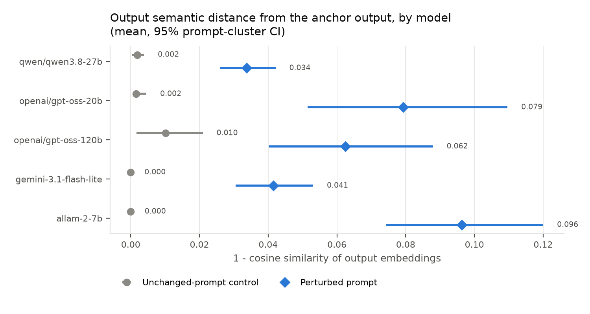
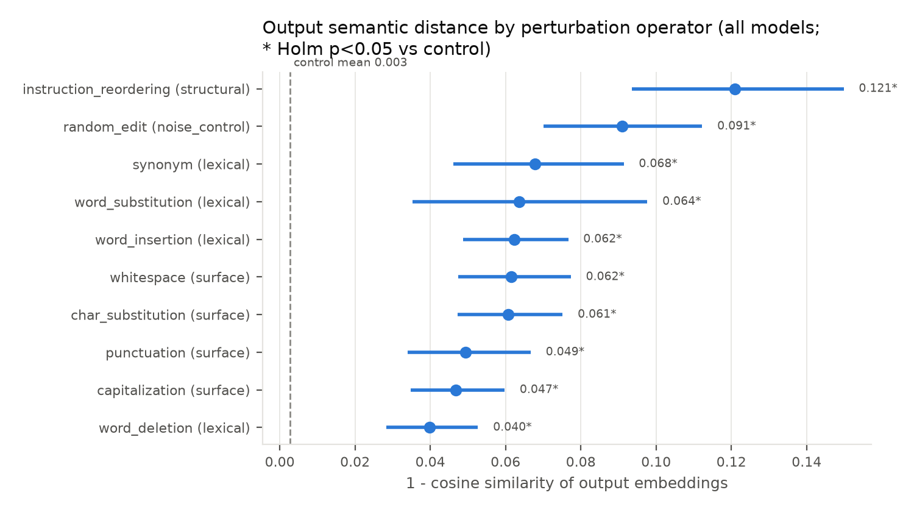
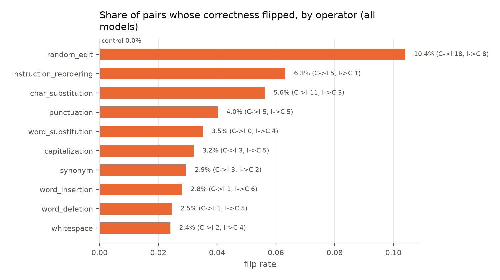
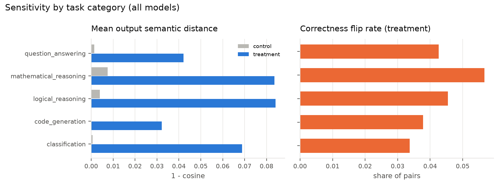
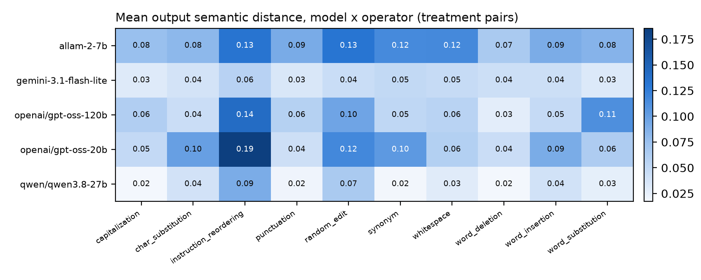
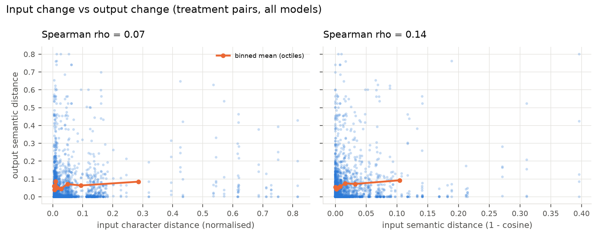
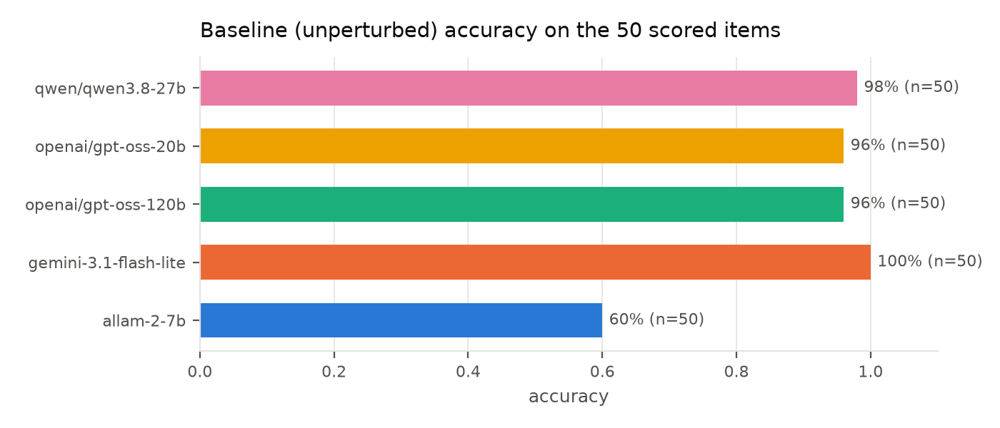

# Small Edits, Shifted Answers: Measuring the Sensitivity of Large Language Models to Minimal Prompt Perturbations

**Abhinav Arora** and **Aditya Kumar Giri** — Adversarial Prompt Sensitivity Analysis (APSA) project

*Draft research paper, November 2026. All results come from live API calls made on 19–20 November 2026 and can be traced to raw records in study `main_v1`.*

## Abstract

Large language models (LLMs) are often queried with prompts that differ only trivially from one another. We measure how much such minimal, controlled prompt perturbations change model outputs, relative to the variation seen when an *unchanged* prompt is simply re-sent. Ten perturbation operators (typos, capitalisation, punctuation, whitespace, filler insertion, function-word deletion, synonym and word substitution, sentence reordering and random character edits) were applied to 50 scorable prompts in five task categories. Each prompt was run on five live models (Qwen 3.8 27B, GPT-OSS-120B, GPT-OSS-20B, ALLaM-2-7B and Gemini 3.1 Flash-Lite) at temperature 0, giving 2,870 generations, with two unchanged-prompt controls per model and prompt. Perturbed prompts changed the output text in 66% of cases, against 7% for identical repeats. Mean semantic output distance was 0.061 against 0.003 for controls (paired Wilcoxon *p* = 6×10⁻⁴¹, rank-biserial *r* = 0.98), and every model and output metric showed the effect. Correctness changed in 4.3% of perturbed pairs and in none of 500 controls; flips went in both directions, so accuracy was essentially unchanged. Strong models kept their answers but not their words (0.9–3.1% flips), whereas the 7B model flipped 14% of the time. A semantic audit showed that the 3.5% of perturbations that unintentionally altered the task caused a correct→incorrect rate of 17.6%, against 1.0% for meaning-preserving edits. Sentence reordering was the most disruptive operator. Input edit distance barely predicted output change (Spearman ρ ≤ 0.14), which is consistent with threshold-like rather than proportional sensitivity. We release the pipeline, raw records and analysis code, and argue that prompt-robustness studies should pair perturbations with unchanged-prompt controls and audit perturbations for meaning preservation.

## 1. Introduction

Large language models (LLMs) are increasingly used through short natural-language prompts. In practice, the same request is phrased in many superficially different ways: with or without a trailing question mark, with a typo, with an extra "carefully", or with its sentences in a different order. If such edits change a model's answer, single-prompt evaluations misstate model capability [Mizrahi et al., 2024; Sclar et al., 2024], and systems built on LLMs inherit an unpredictable failure mode.

This project, *Adversarial Prompt Sensitivity Analysis* (APSA), studies prompt sensitivity as a constrained problem. For an original prompt *P*, a perturbed prompt *P′* and a model *f*, we ask how large the output change *D*out(*f*(*P*), *f*(*P′*)) can be while the input change *D*in(*P*, *P′*) stays below a small budget ε. Two methodological points shape the study:

1. **Temperature 0 does not guarantee identical outputs.** Hosted LLM APIs are not perfectly deterministic even at temperature 0 [Atil et al., 2024]. A perturbation effect is only meaningful relative to the variation seen when the *unchanged* prompt is re-sent. Every treatment comparison in APSA is therefore paired with unchanged-prompt controls for the same model and prompt.
2. **Textual minimality is not semantic preservation.** A one-character edit can rename a required function or corrupt the very entity a question asks about. APSA records lexical and embedding-based input distances separately, flags semantic risk, and audits the perturbations for meaning preservation before interpreting correctness changes.

**Contributions.**
- An open, tested pipeline: perturbation generation, live multi-provider execution with quota-aware resumption, output-distance and correctness scoring, and prompt-clustered statistics.
- A controlled live study: 5 models (open-weight and proprietary) × 50 prompts × 10 perturbation operators, with 2 unchanged-prompt controls per model–prompt.
- Evidence on how large perturbation effects are relative to control noise, which perturbation types and tasks are most sensitive, how input distance relates to output change, and how often correctness flips. Flips are separated into those caused by meaning-preserving and by meaning-altering edits.

## 2. Related Work

**Prompt-format sensitivity.** Sclar et al. (2024) showed that semantically equivalent changes to few-shot prompt *format* (separators, casing, spacing) can move accuracy by up to 76 points for LLaMA-2-13B. They also showed that this spread does not disappear with scale or instruction tuning. Mizrahi et al. (2024) evaluated 20 LLMs on 39 tasks with many paraphrased instruction templates and found that model rankings depend on the template, arguing for multi-prompt evaluation. Lu et al. (2022) and Zhao et al. (2021) documented sensitivity to the order and choice of in-context examples. APSA differs in using zero-shot, single-request prompts, explicit edit-distance budgets, and paired unchanged-prompt controls.

**Adversarial robustness of NLP models.** Character-level attacks (HotFlip; Ebrahimi et al., 2018), synthetic noise (Belinkov & Bisk, 2018) and word-substitution attacks (TextFooler; Jin et al., 2020) showed that small edits can flip classifier predictions. AdvGLUE (Wang et al., 2021) and PromptBench (Zhu et al., 2023) extended this to multi-task benchmarks and LLM prompts. Zou et al. (2023) showed that optimised adversarial suffixes transfer across aligned LLMs. CheckList (Ribeiro et al., 2020) framed such edits as behavioural tests, including invariance tests. APSA's operators are deliberately *non-optimised*, natural-looking edits. Its question is the size of the deviation they produce under a budget, not whether an optimiser can force a target output.

**Non-determinism.** Atil et al. (2024) reported that five LLMs under "deterministic" settings varied in accuracy by up to 15% across repeated runs. This motivates APSA's within-model controls.

## 3. Method

### 3.1 Problem formulation

For prompt *P*, perturbation operator *T* and model *f*, let *P′* = *T*(*P*). We measure:

- **Input distance:** *d*char = Levenshtein(*P*, *P′*) / max(|*P*|, |*P′*|) [Levenshtein, 1966], word-level edit distance, and *d*sem = 1 − cos(e(*P*), e(*P′*)) using the `all-MiniLM-L6-v2` sentence encoder [Reimers & Gurevych, 2019].
- **Output distance (primary):** *D*sem = 1 − cos(e(*Y*), e(*Y′*)) between the two outputs, set to 0 for byte-identical outputs.
- **Output distance (secondary):** normalised character Levenshtein distance, token-Jaccard distance, a binary *final-answer change* indicator, and *correctness flips* (correct→incorrect, C→I; incorrect→correct, I→C).
- **Sensitivity ratio** (descriptive only): *S* = *D*sem / (0.5 *d*char + 0.5 *d*sem + 10−4). Ratios with denominators below 0.01 are flagged as unstable, and absolute deviations are always reported beside them.

### 3.2 Dataset and prompt selection

The APSA baseline dataset has 100 prompts, 20 in each of five categories: mathematical reasoning, logical reasoning, question answering, classification and code generation. Before any output was generated, we fixed the selection rule: take the first 10 prompts per category, in file order, whose evaluation metric is objectively scorable (`exact_match` or `code_execution`). This gives **50 prompts**. Categories were interleaved round-robin so that a run stopped by a quota would still keep category balance.

**Correctness.**
- The 40 non-code items are scored with explicit item-level regular-expression rules applied to the text after the model's `Final answer:` line, or to the whole output when that line is missing. Every rule accepts its own reference answer.
- The 10 code items are executed in an isolated Python subprocess against item-specific unit tests (3–11 assertions each, 10-second timeout). All 10 dataset reference solutions pass.

### 3.3 Perturbation operators

Ten operators from the APSA perturbation engine were used, all with fixed seed 42 (one candidate per prompt and operator):

| Family | Operator | Edit |
|---|---|---|
| Surface | `char_substitution` | one character replaced by a look-alike (e.g. `e`→`3`) |
| Surface | `capitalization` | first word lower-cased |
| Surface | `punctuation` | trailing period/question mark removed (or added) |
| Surface | `whitespace` | single spaces doubled |
| Lexical | `word_insertion` | filler word ("Carefully") inserted at the start |
| Lexical | `word_deletion` | one function word ("the", "a") deleted |
| Lexical | `synonym` | dictionary synonym for a verb (e.g. Find→Locate) |
| Lexical | `word_substitution` | one word replaced from a substitution list |
| Structural | `instruction_reordering` | last sentence moved to the front |
| Noise control | `random_edit` | two random character-level insertions, deletions or replacements (high semantic risk by design) |

Operators that could not edit a prompt were skipped and logged, never replaced by the unchanged prompt. This left **425 accepted candidates** out of 500 (applicable to 34 prompts for synonym, 23 for word_substitution, 19 for instruction_reordering and 49 for word_deletion; all other operators applied to all 50).

### 3.4 Models and generation protocol

Five instruction-tuned models were queried through free API tiers:

- `qwen/qwen3.8-27b` (Groq);
- `openai/gpt-oss-120b` and `openai/gpt-oss-20b` (Groq; open-weight mixture-of-experts reasoning models with 5.1B and 3.6B active parameters [OpenAI, 2025], reasoning effort "low");
- `allam-2-7b` (Groq; a 7B model);
- `gemini-3.1-flash-lite` (Google AI Studio; proprietary).

All requests used temperature 0, a 768-token output cap and the same system prompt. The system prompt asked for a concise answer ending in a `Final answer: <answer>` line, or a single Python code block for coding requests. It is a fixed experimental condition, identical across original, control and perturbed requests.

For every model–prompt pair we generated:

- one **anchor** output for the original prompt;
- two **control** outputs, re-sending the original prompt unchanged;
- one **treatment** output per accepted perturbation.

Each control and treatment output is compared with the anchor, so control and treatment comparisons share the same reference. The runner waits out per-minute rate limits using the provider's suggested delay, records every failed request, and appends raw generations to immutable per-model logs with unique record IDs. Mock (offline) generations are never mixed with live data.

### 3.5 Statistical analysis

The analysis plan (`docs/roadmap/analysis_plan.md`) fixes the following choices.

- **Statistical unit:** the model–prompt pair. For each unit, the treatment metric is averaged over operators and the control metric over the two repeats. Their difference is tested with a two-sided **Wilcoxon signed-rank test** (Wilcoxon, 1945; Pratt's treatment of zeros), with the **matched-pairs rank-biserial correlation** as the effect size (Kerby, 2014).
- **Confidence intervals:** all observations sharing a prompt are correlated, so 95% intervals use a **prompt-level cluster bootstrap** (4,000 resamples) [Efron & Tibshirani, 1993].
- **Per-operator tests:** Holm-corrected across the ten operators (Holm, 1979), with **Cliff's δ** against the control distribution (Cliff, 1993; magnitude thresholds of Romano et al., 2006).
- **Group comparisons:** Kruskal–Wallis tests (with ε²) compare operators, operator families and task categories; a Friedman test (with Kendall's *W*) compares models over prompts that have data for all five models.
- **Correctness flips:** per-operator exact McNemar tests on discordant pairs.
- **Mixed model:** a linear mixed-effects model with a random intercept per prompt estimates operator, task and model effects jointly, adjusting for input distances.
- **Further analyses:** Spearman correlations between input and output distance (RQ4), maxima within input-distance budgets, and a held-out operator-selection check (RQ5).
- **Robustness:** every main contrast is repeated under alternative output metrics and four exclusion specifications.

### 3.6 Semantic-preservation audit

A systematic audit checked whether perturbations preserved meaning (`config/experiments/main_study_semantic_audit.yaml`):

- all accepted candidates of `word_substitution`, `word_deletion`, `char_substitution`, `instruction_reordering` and `synonym` were inspected as word-level diffs against the original prompt;
- a stratified random sample of five candidates was inspected for each other operator.

The audit was prompted by case-study review, which found that a typo had changed the very entity a question asked about. Its judgements were made **on the prompt text only, without looking at model outputs**. Fourteen candidates (50 treatment pairs) were flagged as meaning-altering, falling into four kinds:

- the required function or class name was changed;
- the question was inverted ("valid" → "invalid"; "Q is False" → "Q is True");
- the answer entity or option was corrupted ("Dave" → "D@ve", "Anger" → "@nger");
- a quoted passage was split by sentence reordering.

The audit has not been validated by independent human annotators. This is a limitation (§6).

## 4. Results

### 4.1 Data collected

All 2,875 scheduled generations were attempted, giving **2,870 successful live generations**:

- `qwen/qwen3.8-27b`, `openai/gpt-oss-120b`, `allam-2-7b` and `gemini-3.1-flash-lite` completed all 575 generations each.
- `openai/gpt-oss-20b` completed 570. The 5 missing treatment generations are genuine provider-side failures: the model emitted a spurious tool call and the API rejected the response with HTTP 400. They are recorded, not imputed.
- The Gemini run was interrupted once by a daily quota and once by a network timeout. Both requests later succeeded when the run resumed.

The anchor pairing produced **2,620 analysis pairs** (2,120 treatment, 500 control), with no duplicate keys, malformed records or exclusions. Six automated consistency checks passed, for example: identical outputs never count as answer changes, and all distances lie in [0, 1].

Only 6 generations hit the 768-token cap: 5 from Qwen, 1 from GPT-OSS-20B.

Baseline (anchor) accuracy on the 50 scored items:

| Model | Accuracy |
|---|---|
| `gemini-3.1-flash-lite` | 100% |
| `qwen/qwen3.8-27b` | 98% |
| `openai/gpt-oss-120b` | 96% |
| `openai/gpt-oss-20b` | 96% |
| `allam-2-7b` | **60%** |

ALLaM's low score reflects frequent instruction-following failures, for example writing Python code for a sentiment-classification request (Figure 7).

### 4.2 Controls: how stable is a model on an unchanged prompt?

Re-sending the identical prompt at temperature 0 produced byte-identical outputs in **93%** of the 500 control pairs:

| Model | Identical repeats |
|---|---|
| Gemini | 100% |
| ALLaM | 98% |
| GPT-OSS-20B | 95% |
| Qwen | 88% |
| GPT-OSS-120B | 83% |

The mean semantic output distance of controls was **0.0027**. The largest control change (0.38, GPT-OSS-120B on MATH-002) was a reformatting of the same answer. Most importantly, **no control pair changed correctness (0 of 500)**, and the final-answer string changed in only 0.9% of control pairs. Provider non-determinism is real [Atil et al., 2024], but it is small in this setting and almost never reaches the answer.

### 4.3 Perturbations versus controls (main result)

Across the 250 model–prompt units, perturbed prompts changed outputs far more than unchanged repeats did (Table 1, Figure 1):

- mean semantic output distance **0.061 vs 0.003**: paired difference +0.059, 95% CI [0.048, 0.070], Wilcoxon *p* = 6×10⁻⁴¹, rank-biserial *r* = 0.98;
- **66% of perturbed outputs differed** from the anchor, versus 7% of control outputs.

The effect is significant for every model separately (all *p* < 10⁻⁷) and on every output metric.

**Table 1.** Treatment minus control, paired by model–prompt (all models; *n* = 250 units, or 234 for the answer-change metric).

| Outcome | Perturbed | Control | Difference [95% CI] | Wilcoxon *p* | *r* |
|---|---|---|---|---|---|
| Semantic distance (primary) | 0.061 | 0.003 | +0.059 [0.048, 0.070] | 6×10⁻⁴¹ | 0.98 |
| Character distance | 0.215 | 0.013 | +0.202 [0.172, 0.233] | 2×10⁻⁴¹ | 0.99 |
| Token Jaccard distance | 0.250 | 0.016 | +0.234 [0.204, 0.265] | 1×10⁻⁴⁰ | 0.99 |
| Final-answer string changed | 0.171 | 0.009 | +0.162 [0.126, 0.202] | 1×10⁻¹⁸ | 0.97 |

The final-answer string metric is an **upper bound** on substantive answer changes. In a check of 14 randomly sampled answer-string changes that did not flip correctness:

- 9 were rewordings of the same answer (e.g. "Valid" vs "Valid. All penguins have feathers");
- 3 were a missing `Final answer:` line;
- 2 were substantive.

**Correctness changes are rarer but real.** Of the 2,120 perturbed pairs, **4.3%** changed correctness: 2.3% correct→incorrect and 2.0% incorrect→correct. Not one of the 500 controls did. Perturbations therefore *reshuffle* correctness rather than systematically lowering it: overall accuracy on perturbed prompts (89.4%) is close to anchor accuracy (90.0%).

### 4.4 Which perturbations matter? (RQ1)

Every operator, including doubling the spaces and lower-casing the first letter, changed outputs significantly more than the control (all Holm-corrected *p* < 10⁻¹³; Cliff's δ from 0.45 to 0.80, i.e. medium to large).

**Instruction reordering** was the most disruptive operator:
- mean semantic distance 0.121;
- final-answer string changed in 39% of pairs;
- Cliff's δ = 0.80.

**Word deletion** (0.040) and **capitalization** (0.047) were the least disruptive. Operators differed significantly (Kruskal–Wallis *H* = 88.2, *p* = 4×10⁻¹⁵), but the effect size was small (ε² = 0.04).

By family:

| Family | Mean semantic distance |
|---|---|
| Structural | 0.121 |
| Noise control (`random_edit`) | 0.091 |
| Lexical | 0.057 |
| Surface | 0.055 |

**Hypothesis H1 is therefore not supported.** Surface edits were not more disruptive than other families; structural reordering was. However, input distance differs strongly between operators: reordering has a character distance of 0.53, against 0.007 for a single typo. Once input distances, task and model are adjusted for in the mixed model (§4.7), only `random_edit` keeps a significant operator effect (+0.034, 95% CI [0.012, 0.057]). The reordering coefficient remains large (+0.055) but uncertain (CI [−0.013, 0.123]), because only 19 prompts could be reordered.

Correctness flips by operator ranged from 2.4% (whitespace) to 10.4% (`random_edit`), with char_substitution at 5.6% and instruction_reordering at 6.3% (Figure 3). Flips went in both directions, and no per-operator McNemar test was significant after Holm correction. Two operators leaned towards harm:

- `random_edit`: 18 correct→incorrect vs 8 incorrect→correct;
- `char_substitution`: 11 vs 3.

### 4.5 Meaning-preserving versus meaning-altering edits

**Table 2.** Correctness flips by semantic-audit status (treatment pairs).

| Perturbations | Pairs | C→I | I→C | Any flip [95% CI] |
|---|---|---|---|---|
| Audit-valid (meaning preserved) | 1,796 | 18 (1.0%) | 32 (1.8%) | 2.8% [1.8, 3.9] |
| Audit-flagged meaning-altering | 74 | 13 (17.6%) | 3 (4.1%) | 21.6% [8.1, 37.5] |
| `random_edit` (noise control) | 250 | 18 (7.2%) | 8 (3.2%) | 10.4% [4.8, 17.2] |

The semantic audit separates two very different phenomena (Table 2).

- **Meaning-preserving edits** flipped correctness in 2.8% of pairs, and more often *towards* the correct answer than away from it.
- **The 15 audit-flagged meaning-altering candidates** (74 pairs) produced a correct→incorrect rate of **17.6%**, 17 times higher. Typical flagged edits were a corrupted answer option ("Anger" → "@nger"), a corrupted entity ("Liam Chen" → "Liam Ch3n") and inverted questions.

A large share of the apparent "fragility" in naïve perturbation studies can therefore be the perturbation changing the task, not the model failing it. Even so, the main treatment-versus-control effect is essentially unchanged when meaning-altering and random edits are excluded: difference +0.052, 95% CI [0.042, 0.064], *p* = 1×10⁻³⁹.

**Genuine failures under meaning-preserving edits.** All 18 audit-valid correct→incorrect flips were reviewed individually. **Fourteen are genuine model errors** (a wrong number, entity or label). Three are answer-format failures: twice ALLaM stated the correct label in its explanation but restated the hypothesis on its `Final answer:` line, and once GPT-OSS-20B gave the seat number "4" instead of the name "Dave". One is a truncation at the token cap. Notable examples (full outputs in `analysis/case_studies.json` and the output viewer):

- **Removing a "?"** made ALLaM name *Werner Heisenberg* instead of Albert Einstein as the 1921 Nobel laureate (QA-001).
- **Appending a "."** after a quoted Spanish sentence made Qwen classify it as *Portuguese* (CLASS-006).
- **Replacing "Classify" with "Categorize"** made GPT-OSS-120B label a central-bank interest-rate headline *Politics* instead of *Business* (CLASS-002).
- **A single typo** ("1" for "i") changed Qwen's severity label for an application-crash report from *Critical* to *High* (CLASS-008).
- **Lower-casing the first letter** of a word problem made ALLaM answer $9.60 instead of $7.20 (MATH-001). Four other one-character edits to the same prompt produced four further, different wrong answers.

### 4.6 Task categories (RQ2) and models (RQ3)

Sensitivity differed by task (Kruskal–Wallis on prompt-level means, *H* = 15.4, *p* = 0.004, ε² = 0.31).

| Category | Semantic distance | Final-answer string change | Flip rate | C→I rate |
|---|---|---|---|---|
| Logical reasoning | 0.084 | 35.5% | 4.5% | 1.4% |
| Mathematical reasoning | 0.084 | 24.9% | 5.7% | 3.9% |
| Classification | 0.069 | 13.4% | 3.4% | 2.2% |
| Question answering | 0.042 | 20.0% | 4.3% | 4.3% |
| Code generation | 0.032 | 3.8% | 3.8% | 0.2% |

- **Reasoning tasks** produced the largest semantic changes and the most answer-string changes.
- **Mathematical reasoning** had the highest flip rate.
- **Code generation** was the most stable. Its outputs (a single code block) changed least, and only 1 of 449 code pairs turned a passing solution into a failing one.

H2 ("structured-output tasks fail catastrophically more often") is therefore **partly supported**: it holds for mathematics but not for code.

Models differed significantly (Friedman χ² = 19.5, *p* = 0.0006, Kendall's *W* = 0.10).

| Model | Semantic distance | Flip rate |
|---|---|---|
| `allam-2-7b` | 0.096 | 14.4% |
| `openai/gpt-oss-20b` | 0.079 | 2.1% |
| `openai/gpt-oss-120b` | 0.062 | 1.2% |
| `gemini-3.1-flash-lite` | 0.041 | 0.9% |
| `qwen/qwen3.8-27b` | 0.034 | 3.1% |

After Holm correction, ALLaM was significantly more sensitive than Gemini and Qwen. Within the GPT-OSS pair (same family, 5.1B vs 3.6B active parameters), the larger model was less sensitive, but the difference was not significant (Holm *p* = 0.38).

H3 is thus **consistent with, but not established by,** our data. The least capable model was by far the most fragile and the strong models were robust in correctness, but vendor, architecture, training and size vary together across these five models, so no causal scale effect can be identified.

### 4.7 Mixed-effects model

A linear mixed model of semantic output distance on the treatment pairs fit with a random intercept per prompt (*n* = 2,120, 50 prompts, REML via Powell optimisation; random-intercept variance 0.0013, residual variance 0.011). Relative to ALLaM:

| Model | Coefficient | 95% CI |
|---|---|---|
| Qwen | −0.063 | [−0.077, −0.048] |
| Gemini | −0.055 | [−0.069, −0.041] |
| GPT-OSS-120B | −0.034 | [−0.048, −0.020] |
| GPT-OSS-20B | −0.017 | [−0.032, −0.003] |

Code generation was lower than classification (−0.036, CI [−0.070, −0.001]). Holding operator, task and model fixed, neither input character distance (+0.019, CI [−0.10, 0.14]) nor input semantic distance (+0.119, CI [−0.03, 0.27]) significantly predicted output change.

### 4.8 Input distance versus output distance (RQ4)

Output change was only weakly related to input change. Pooled Spearman correlations were:

- ρ = 0.07 for input character distance;
- ρ = 0.14 for input semantic distance.

The binned means are almost flat (Figure 5). The distribution of output change is bimodal-like: **39% of treatment pairs show no output change at all**, while others show large jumps from one-character edits. Under a character budget of only ε = 0.01 (typically a single character), 698 evaluated pairs contained 20 correct→incorrect flips, and the largest observed semantic output distance was 0.65.

This pattern is *consistent with* H4's threshold ("phase transition") view: whether an output changes depends on which token is edited, much more than on how much text is edited. A formal change-point analysis was not performed.

The sensitivity ratio *S* is heavy-tailed: median 0.35, 99th percentile 67, maximum 174. A GEV fit to its top 5% has shape *c* = −0.78 in scipy's convention (*n* = 106). **63% of the top-decile ratios had near-zero input distance** (< 0.01), so the largest "sensitivities" are mainly denominator effects. This supports reporting absolute output deviation as the primary quantity.

The largest observed output distance (0.80, reached within every budget from ε = 0.02 up) was GPT-OSS-120B on LOGIC-010. The model replied with just `Final answer: True` instead of a full explanation: the answer was unchanged and correct. Embedding distance therefore captures **verbosity and style changes** as well as meaning changes, which is why correctness flips are reported alongside it.

### 4.9 Can perturbation choice be optimised? (RQ5, proxy)

Picking, for each model–prompt, the most disruptive of the nine non-random operators gave a mean output distance of 0.149, against 0.091 for the single `random_edit` candidate. That is a ratio of **1.64**, below the ≥ 3× predicted by H5 (Wilcoxon *p* < 10⁻¹⁰). This oracle comparison is biased in favour of selection, because it takes the best of nine candidates against one and uses the outputs themselves to choose (the winner's curse).

The fairer **held-out test** chose each model's most disruptive operator on half of the prompts and evaluated it on the other half. It did not beat `random_edit` for any model. For ALLaM the chosen operator (whitespace) was in fact *less* disruptive on held-out prompts (0.091 vs 0.145).

**H5 is not supported** by this proxy. Fixed operator choice does not generalise as an attack strategy. Token-level search (greedy, beam), which RQ5 actually asks about, was not run and remains future work.

### 4.10 Output-change taxonomy (Phase 15)

Every pair received one mutually exclusive label, assigned by severity.

| Label | Treatment pairs (*n* = 2,120) | Control pairs (*n* = 500) |
|---|---|---|
| Identical output | 727 (34.3%) | 464 (92.8%) |
| Wording change only (semantic distance < 0.05, same answer) | 602 (28.4%) | 27 (5.4%) |
| Content change, same answer | 396 (18.7%) | 5 (1.0%) |
| Final-answer string change, same correctness | 259 (12.2%) | 3 (0.6%) |
| Correctness flip correct→incorrect | 48 (2.3%) | 0 |
| Correctness flip incorrect→correct | 43 (2.0%) | 0 |
| Format-instruction violation (marker dropped) | 39 (1.8%) | 1 (0.2%) |
| Truncation at the token cap | 6 (0.3%) | 0 |

**Most perturbation effects are changes of form, not of substance.** Strong models usually reach the same answer through different wording. Substantive failures are concentrated in the weakest model and in meaning-altering edits.

## 5. Discussion

**Small edits reliably change *how* models answer, and occasionally *what* they answer.** Even edits a human reader would ignore (a doubled space, a dropped question mark, a lower-case first letter) changed the output text of every model in a majority of cases. This is not provider noise: identical repeats almost never changed, and never changed correctness. For anyone who evaluates or deploys LLMs, it follows that a single prompt wording is a sample, not a measurement, as argued by Mizrahi et al. (2024) and Sclar et al. (2024). Our results extend that point to zero-shot, single-turn prompts and to minimal, natural-looking edits.

**Correctness is far more robust than wording, for capable models.**
- The four strong models changed correctness in only 0.9–3.1% of perturbed pairs.
- They kept 94–99% accuracy under perturbation.
- The 7B model flipped 14% of the time, in both directions, so its *answers* behave like noisy samples around a coin-flip-quality baseline. In an application, robustness testing should therefore focus on the answer, using tests and answer keys, and not on text similarity.

**Validating perturbations is essential.** Purely mechanical operators sometimes changed the task: renaming a required function, inverting "valid" to "invalid", or corrupting the very entity to be extracted. Those 15 candidates (3.5% of the candidate set) produced 13 of the 49 correct→incorrect flips. Without a semantic audit, such cases would be counted as model fragility. Embedding similarity alone did not catch them: 11 of the 15 had input cosine distances below 0.05, and inverting "False" to "True" in a function specification moved the input embedding by only 0.001. Perturbation studies should report an audit like ours.

**Distance budgets are a weak proxy for "minimal".** Output change was almost independent of input edit distance. A whitespace edit with character distance 0.14 had less effect on correctness than one-character typos (distance 0.007). This suggests that the *location and role* of the edited token (an answer option, an identifier, a question word) matters more than the edit's size. That motivates token-role-aware perturbation budgets instead of pure edit-distance budgets.

## 6. Limitations and threats to validity

- **Scale and sampling.**
  - Only 50 prompts were used (10 per category), each with one seed-42 candidate per operator.
  - Prompts were selected by a fixed rule favouring scorable items, so results may not generalise to open-ended generation.
  - Category-level estimates rest on 10 prompts each.
- **Models and providers.**
  - Five models were accessed through free API tiers on one day; providers may update models silently.
  - The models differ in many respects at once, so model comparisons are descriptive, not causal.
  - Only temperature 0 was studied. The temperature-0.7 condition named in the methodology was not run.
- **The fixed system prompt** (asking for a `Final answer:` line) makes answers scorable but may itself reduce, or alter, sensitivity compared with unconstrained use.
- **Metrics.**
  - Output embedding distance (MiniLM) measures topical and stylistic similarity, not truth. It is sensitive to verbosity (§4.8).
  - The final-answer string metric is an upper bound on substantive answer change.
  - The sensitivity ratio is unstable for near-zero input distances.
  - Syntactic tree-edit input distance is not implemented.
- **Correctness scoring.** It is automated: item-level regular expressions for 40 items and unit tests for 10 code items.
  - A check of 40 randomly sampled verdicts found 1 error, which was fixed before the final analysis.
  - The unit tests are small, so a "pass" is not a proof of correctness.
  - Reference answers were not independently reviewed by domain experts.
- **Semantic audit.** It has not been validated by independent human annotators. It was triggered after reviewing case studies, although its judgements used prompt text only. A second, human annotator with an agreement statistic is needed for publication.
- **Pre-specification.** The analysis plan was written during data collection, after a partial look at early results during pipeline debugging. We therefore report all planned analyses, null results included.
- **RQ5.** It was addressed only by an operator-selection proxy. No token-level search was run.

## 7. Conclusion

We built and validated an end-to-end framework for measuring LLM sensitivity to minimal prompt perturbations, and applied it to five live models with paired unchanged-prompt controls. The findings:

- **Small edits significantly change outputs.** Mean semantic distance is 0.061 vs 0.003 for controls, and 66% vs 7% of outputs change.
- **Final answers occasionally change, and correctness flips do occur** (4.3% vs 0% for controls).
- **Strong models mostly keep their answers but not their words**, while a small 7B model is markedly fragile.
- **Meaning-altering edits**, which naïve operators produce more often than expected, are the dominant source of correctness failures.
- **The size of the input edit says little** about the size of its effect.

Future work: human-validated perturbation audits, token-role-aware budgets, stochastic decoding, larger and open-ended prompt sets, and genuine adversarial search.

## Reproducibility statement

- **Code:** `experiments/run_study.py` (data collection), `experiments/analyze_study.py` (all statistics and figures) and `experiments/demo.py`.
- **Configuration:** `config/experiments/main_study.yaml`, whose SHA-256 is recorded in the study manifest.
- **Records:** raw generations are append-only JSONL with unique record IDs, and every number in this paper is generated into `results/study/main_v1/analysis/results.json`. Each analysis pair links back to its raw records.
- **Tests:** the test suite (231 tests) covers the perturbation engine, metrics, statistics helpers, scoring, rate-limit handling and the study runner.
- **Environment:** exact package versions are in `requirements-lock.txt`.

## References

- Atil, B., et al. (2024). Non-Determinism of "Deterministic" LLM Settings. arXiv:2408.04667.
- Belinkov, Y., & Bisk, Y. (2018). Synthetic and Natural Noise Both Break Neural Machine Translation. *ICLR 2018*.
- Cliff, N. (1993). Dominance statistics: Ordinal analyses to answer ordinal questions. *Psychological Bulletin*, 114(3), 494–509.
- Ebrahimi, J., Rao, A., Lowd, D., & Dou, D. (2018). HotFlip: White-Box Adversarial Examples for Text Classification. *ACL 2018*.
- Efron, B., & Tibshirani, R. J. (1993). *An Introduction to the Bootstrap*. Chapman & Hall.
- Holm, S. (1979). A simple sequentially rejective multiple test procedure. *Scandinavian Journal of Statistics*, 6(2), 65–70.
- Jin, D., Jin, Z., Zhou, J. T., & Szolovits, P. (2020). Is BERT Really Robust? A Strong Baseline for Natural Language Attack on Text Classification and Entailment. *AAAI 2020*.
- Kerby, D. S. (2014). The simple difference formula: An approach to teaching nonparametric correlation. *Comprehensive Psychology*, 3.
- Levenshtein, V. I. (1966). Binary codes capable of correcting deletions, insertions, and reversals. *Soviet Physics Doklady*, 10(8), 707–710.
- Lu, Y., Bartolo, M., Moore, A., Riedel, S., & Stenetorp, P. (2022). Fantastically Ordered Prompts and Where to Find Them: Overcoming Few-Shot Prompt Order Sensitivity. *ACL 2022*.
- Mizrahi, M., Kaplan, G., Malkin, D., Dror, R., Shahaf, D., & Stanovsky, G. (2024). State of What Art? A Call for Multi-Prompt LLM Evaluation. *Transactions of the ACL*, 12, 933–949.
- OpenAI (2025). gpt-oss-120b & gpt-oss-20b Model Card. arXiv:2508.10925.
- Reimers, N., & Gurevych, I. (2019). Sentence-BERT: Sentence Embeddings using Siamese BERT-Networks. *EMNLP 2019*.
- Ribeiro, M. T., Wu, T., Guestrin, C., & Singh, S. (2020). Beyond Accuracy: Behavioral Testing of NLP Models with CheckList. *ACL 2020*.
- Romano, J., Kromrey, J. D., Coraggio, J., & Skowronek, J. (2006). Appropriate statistics for ordinal level data: Should we really be using t-test and Cohen's d for evaluating group differences on the NSSE and other surveys? *Annual meeting of the Florida Association of Institutional Research*.
- Sclar, M., Choi, Y., Tsvetkov, Y., & Suhr, A. (2024). Quantifying Language Models' Sensitivity to Spurious Features in Prompt Design or: How I learned to start worrying about prompt formatting. *ICLR 2024*.
- Wang, B., Xu, C., Wang, S., Gan, Z., Cheng, Y., Gao, J., Awadallah, A. H., & Li, B. (2021). Adversarial GLUE: A Multi-Task Benchmark for Robustness Evaluation of Language Models. *NeurIPS 2021 Datasets and Benchmarks*.
- Wilcoxon, F. (1945). Individual comparisons by ranking methods. *Biometrics Bulletin*, 1(6), 80–83.
- Zhao, Z., Wallace, E., Feng, S., Klein, D., & Singh, S. (2021). Calibrate Before Use: Improving Few-Shot Performance of Language Models. *ICML 2021*.
- Zhu, K., et al. (2023). PromptBench: Towards Evaluating the Robustness of Large Language Models on Adversarial Prompts. arXiv:2306.04528.
- Zou, A., Wang, Z., Kolter, J. Z., & Fredrikson, M. (2023). Universal and Transferable Adversarial Attacks on Aligned Language Models. arXiv:2307.15043.

## Appendix A. Figure 7 and artifact index

| Artifact | Location |
|---|---|
| Study configuration | `config/experiments/main_study.yaml` |
| Semantic audit | `config/experiments/main_study_semantic_audit.yaml` |
| Raw generations | `results/study/main_v1/raw/` |
| Analysis dataset | `results/study/main_v1/processed/analysis_pairs.csv` |
| All statistics | `results/study/main_v1/analysis/results.json`, `results_tables.md` |
| Case studies / output viewer | `results/study/main_v1/analysis/case_studies.json`, `output_viewer.html` |
| Analysis plan | `docs/roadmap/analysis_plan.md` |
| Verification report | `docs/roadmap/phases_11_to_17_verification.md` |
